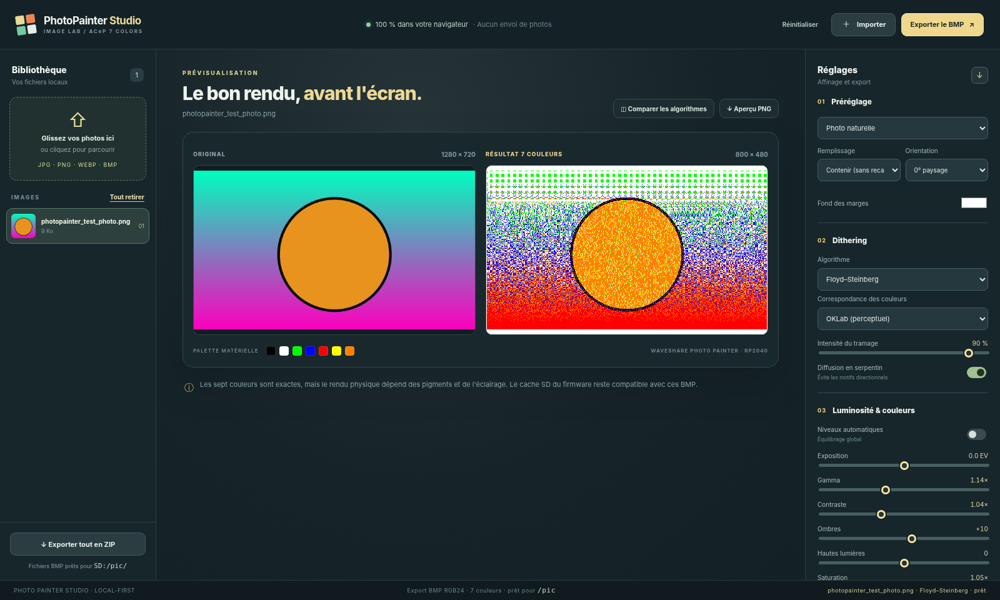

# PhotoPainter Studio Web

[English](#english) | [Français](#français)

## English

A **100% static** Web application for preparing photos for the **Waveshare PhotoPainter RP2040, 7.3-inch seven-color ACeP panel** (800×480). All processing happens **in your browser**: images are never uploaded to a server.



### Features

- JPG, JPEG (including progressive files if the browser decodes them), PNG, WEBP and BMP images.
- Original / converted seven-color or black-and-white preview, updated in real time after settings change.
- **Black-and-white** modes: dithered photo, soft, contrast and threshold/ink (no dithering), with black/white points, threshold and inversion. Apparent grays are simulated with black and white, never exported as a third shade.
- Eleven methods: **no dithering, Floyd–Steinberg, Atkinson, Sierra Lite, Burkes, Stucki, Jarvis–Judice–Ninke, Bayer 4×4 / 8×8 / 16×16, distributed noise**.
- Color matching: perceptual OKLab, simple RGB or weighted RGB.
- Photo adjustments: mouse-controlled zoom and crop, per-photo settings, orientation, background color, exposure, gamma, contrast, shadows, highlights, saturation, vibrance, temperature, tint, sharpness, light denoising and automatic levels.
- Presets, automatic browser storage and JSON import/export.
- **Native EPD** export (recommended) or RGB24 BMP, individually or in a `pic/` ZIP archive. EPD requires firmware 0.4.0 or later; the current `FW_VERSION` in `../platformio.ini` is `0.4.1`.
- Comparison of six algorithms in one window.
- Frame configuration page with `settings.conf` import/export and threshold validation.
- **Firmware & flash** tab: latest GitHub Actions build and latest stable firmware download, version and SHA-256 hash display, and UF2 flashing instructions.
- Web Serial for `STATUS`, `NEXT`, `SETTIME` (Chrome/Chromium, HTTPS or localhost); no SD copying over USB.
- Installable PWA and offline operation after caching.
- No external dependencies, CDN, compilation or backend.

### Deploy to GitHub Pages (from the complete repository)

The converter is part of the **PhotoPainter RP2040 monorepo**: firmware and `platformio.ini` stay at the root; the site lives in `tools/`.

The single workflow is [`../.github/workflows/build-and-publish.yml`](../.github/workflows/build-and-publish.yml). It runs tests, compiles RP2040 firmware with PlatformIO and publishes **`tools/` with the latest successfully built UF2**. It also publishes stable releases on `vX.Y.Z` tags, after checking the tag against the firmware version.

1. Push **the entire repository** (firmware and `tools/`) to `main`.
2. Check that the hidden `.github/workflows/` directory is at the repository root, not in `tools/`.
3. In **Settings → Pages → Build and deployment**, select **GitHub Actions**.
4. Check that **Build firmware and publish Studio** succeeds in **Actions**.
5. Open [PhotoPainter Studio](https://maelremrem.github.io/Waveshare-PhotoPainter-RP2040/). For a fork, use its own GitHub Pages address.

Read the [main README](../README.md) for complete Git instructions and the original Waveshare project reference.

> The site needs neither a backend nor compilation. Photos are processed locally in the browser.

### Firmware and flashing from Studio

The **Firmware & flash** tab offers two independent downloads:

- **Latest stable release:** the `PhotoPainter-RP2040.uf2` asset from the latest GitHub release, if one exists.
- **Latest `main` build:** `firmware/PhotoPainter-RP2040-main.uf2`, automatically included in the site only after a successful build. Version, date and SHA-256 checksum come from `firmware/build.json`, generated by GitHub Actions. A “no published UF2” message is normal on a local development server.

The page also describes BOOTSEL flashing: press BOOT + RUN, locate the `RPI-RP2` volume, copy the UF2, restart and run `STATUS` in the serial monitor. The site does **not** flash hardware directly: manual interaction with the USB drive is required. The build requires an Internet-connected GitHub Actions runner to download PlatformIO and the RP2040 core.

### Local testing

The page uses an **ES module Web Worker** to keep the interface responsive. Serve it over HTTP(S); do not open `index.html` by double-clicking with `file://`. Run these commands from `tools/`.

With Node.js installed (**no dependency installation**):

```bash
npm run dev
```

Or, if Python is already installed, to serve the static site only:

```bash
python3 -m http.server 8000
```

Then open `http://localhost:8000/`.

### Use with an SD card

1. Import photos into the page.
2. Choose settings and check the preview.
3. Select **native EPD** (firmware 0.4.0 or later), then export one image or the complete ZIP. **BMP** remains available for older firmware.
4. For ZIP: extract to the **microSD root**; it contains a ready-to-use `pic/` directory. Keep the existing `settings.conf` on the card.
5. In the firmware serial monitor, run `RESCAN`, then `NEXT`.

**Native EPD:** 24-byte header + 192000 bytes of quantized ACeP pixels, always in physical 800×480 order. Studio rotation is already included; the firmware's `orientation` setting does not affect these files. Firmware checks the header, indices and CRC32 before refreshing the panel. See [`docs/EPD_FORMAT.md`](../docs/EPD_FORMAT.md).

**BMP:** 24-bit RGB/BGR 800×480 (or portrait 480×800), with already quantized pixels. If you export BMP at 90°, also keep `orientation=90` in `settings.conf`; otherwise rotation will be incorrect.

On the “Configure frame” page, export `settings.conf` and copy it to the SD root. Including it in the ZIP is disabled by default to avoid unintentionally replacing your configuration.

**Important:** the preview represents the nominal palette. Actual contrast and shades depend on the panel, lighting and display firmware.

### Limitations

- ZIP archives use uncompressed storage to avoid dependencies and preserve BMP files. Many large photos can produce large ZIP files and high memory usage.
- TIFF and HEIC loading depends on the browser and is not explicitly supported.
- Image processing is local; process very large libraries in batches.
- Per-photo settings persist only while photos remain open in the tab. Global settings are stored locally in the browser.
- Dithering does not create extra colors: it simulates visual mixtures of the available physical colors (seven in color mode, two in black-and-white mode).

### Project files

```text
README.md
platformio.ini
src/                       # RP2040 firmware
include/
sdcard/
tools/
├── index.html
├── assets/
│   ├── style.css
│   └── favicon.svg
├── js/
│   ├── app.js
│   ├── engine.js
│   ├── worker.js
│   └── zip.js
├── scripts/dev-server.mjs
├── tests/engine.test.mjs
├── package.json
├── .nojekyll
└── README.md
.github/
└── workflows/build-and-publish.yml  # Tests, firmware build, Pages and releases
```

### License

Original PhotoPainter Studio Web code is licensed under **Apache-2.0** (see [`../LICENSE`](../LICENSE)). Waveshare adaptations and external dependencies retain their notices in [`../NOTICE.md`](../NOTICE.md).

---

## Français

[English](#english) | [Français](#français)

Une application Web **100 % statique** pour préparer des photos pour le **Waveshare PhotoPainter RP2040 – dalle ACeP 7,3 pouces à 7 couleurs** (800×480). Tout le traitement s'effectue **dans votre navigateur** : les images ne sont jamais envoyées à un serveur.


## Fonctions

- Images JPG, JPEG (y compris progressifs si le navigateur les décode), PNG, WEBP et BMP.
- Aperçu original / version convertie en 7 couleurs ou en noir et blanc, en temps réel après modification des paramètres.
- Modes **noir et blanc** : photo tramée, doux, contrasté et seuil/encre (sans tramage), avec points noir/blanc, seuil et inversion. Les gris apparents sont simulés en noir et blanc, jamais exportés comme une troisième teinte.
- Onze méthodes : **aucun tramage, Floyd–Steinberg, Atkinson, Sierra Lite, Burkes, Stucki, Jarvis–Judice–Ninke, Bayer 4×4 / 8×8 / 16×16, bruit réparti**.
- Correspondance des couleurs : OKLab perceptuel, RGB simple ou RGB pondéré.
- Photo : zoom et recadrage à la souris, réglages par photo, orientation, couleur de fond, exposition, gamma, contraste, ombres, hautes lumières, saturation, vibrance, température, teinte, netteté, débruitage léger, niveaux automatiques.
- Préréglages, sauvegarde automatique dans le navigateur et import / export JSON.
- Export **EPD natif** (recommandé) ou BMP RGB24, individuellement ou par archive ZIP `pic/`. Le format EPD nécessite le firmware 0.4.0 ou ultérieur ; la version `FW_VERSION` actuelle dans `../platformio.ini` est `0.4.1`.
- Comparaison de six algorithmes en une fenêtre.
- Page de configuration du cadre avec import/export `settings.conf` et validation des seuils.
- Onglet **Firmware & flash** : téléchargement du dernier firmware compilé dans GitHub Actions et de la dernière version stable, affichage de la version, du hash SHA-256 et instructions de flash UF2.
- Web Serial pour `STATUS`, `NEXT`, `SETTIME` (Chrome/Chromium, HTTPS ou localhost) ; aucune copie SD par USB.
- PWA installable et fonctionnement hors connexion après mise en cache.
- Aucune dépendance externe, pas de CDN, pas de compilation, pas de backend.

## Déployer sur GitHub Pages (depuis le dépôt complet)

Ce convertisseur est inclus dans le **dépôt monorepo PhotoPainter RP2040** : le firmware et `platformio.ini` restent à la racine, tandis que le site vit dans `tools/`.

Le workflow unique est dans **`../.github/workflows/build-and-publish.yml`**. Il exécute les tests, compile le firmware RP2040 avec PlatformIO et publie **le site `tools/` accompagné du dernier UF2 construit avec succès**. Il publie également une release stable sur tag `vX.Y.Z`, après vérification de la concordance du tag avec la version du firmware.

1. Pousser **tout le dépôt** (firmware et `tools/`) sur la branche `main`.
2. Vérifier la présence du répertoire caché `.github/workflows/` (dans la racine du dépôt, et non dans `tools/`).
3. Dans **Settings → Pages → Build and deployment**, sélectionner **GitHub Actions**.
4. Vérifier la réussite du workflow **Build firmware and publish Studio** dans l'onglet **Actions**.
5. Ouvrir [PhotoPainter Studio](https://maelremrem.github.io/Waveshare-PhotoPainter-RP2040/). Pour un fork, utiliser sa propre adresse GitHub Pages.

Lire le [README principal](../README.md) pour les instructions Git complètes et la référence au projet Waveshare d'origine.

> Le site n'a besoin ni de backend ni de compilation. Les photos restent traitées localement par le navigateur.

## Firmware et flash depuis Studio

L'onglet **Firmware & flash** propose deux téléchargements indépendants :

- **Dernière version stable** : asset `PhotoPainter-RP2040.uf2` de la dernière release GitHub, quand elle existe.
- **Dernier build de `main`** : `firmware/PhotoPainter-RP2040-main.uf2`, automatiquement incorporé au site uniquement après un build réussi. La version, la date et l'empreinte SHA-256 sont affichées à partir de `firmware/build.json` généré par GitHub Actions. Sur un serveur de développement local, le message « aucun UF2 publié » est normal.

La page décrit aussi le flash BOOTSEL : appui BOOT + RUN, volume `RPI-RP2`, copie de l'UF2, redémarrage et commande `STATUS` dans le moniteur série. Le site ne flashe **pas** directement le matériel : une interaction manuelle avec le lecteur USB est nécessaire. Le build exige un runner GitHub Actions connecté à Internet pour télécharger PlatformIO et le cœur RP2040.

## Tester en local

La page utilise un **Web Worker de type ES module** pour ne pas figer l'interface. Elle doit être servie par HTTP(S), pas ouverte en double-cliquant sur `index.html` avec `file://`. Exécuter les commandes suivantes depuis `tools/`.

Avec Node.js installé (**sans installer de dépendances**) :

```bash
npm run dev
```

Ou, si Python est déjà installé, uniquement pour servir le site statique :

```bash
python3 -m http.server 8000
```

Puis ouvrir `http://localhost:8000/`.

## Utilisation avec la carte SD

1. Importer les photos dans la page.
2. Choisir les réglages, vérifier le rendu dans l'aperçu.
3. Choisir **EPD natif** (pour le firmware 0.4.0 ou ultérieur), puis exporter l’image ou tout le ZIP. **BMP** reste disponible pour les anciens firmwares.
4. Pour le ZIP : extraire à la **racine de la microSD** ; il contient un dossier `pic/` prêt à l'emploi. Conserver le `settings.conf` déjà présent sur la carte.
5. Sur le moniteur série du firmware : `RESCAN`, puis `NEXT`.

**EPD natif :** 24 octets d'en-tête + 192000 octets de pixels ACeP quantifiés, toujours dans l'ordre physique 800×480. La rotation Studio y est déjà intégrée, et la valeur `orientation` du firmware n'affecte pas ces fichiers. Le firmware vérifie l'en-tête, les indices et le CRC32 avant de rafraîchir la dalle. Voir [`docs/EPD_FORMAT.md`](../docs/EPD_FORMAT.md).

**BMP :** 24 bits RGB/BGR 800×480 (ou 480×800 portrait), pixels déjà quantifiés. Si vous exportez du BMP en 90°, conservez également `orientation=90` dans `settings.conf`, sinon la rotation sera incorrecte.

Sur la page « Configurer le cadre », exportez `settings.conf` à copier à la racine de la SD. L'option d'inclure ce fichier dans le ZIP est désactivée par défaut pour éviter de remplacer involontairement votre configuration.

**Important** : l'aperçu représente la palette nominale. Le contraste et les nuances réellement affichés dépendent de la dalle, des éclairages et du firmware de l'écran.

## Limites

- Les archives ZIP utilisent le stockage non compressé pour fonctionner sans dépendance et préserver les BMP. Pour beaucoup de grandes photos, la taille du ZIP et l'utilisation mémoire peuvent être importantes.
- Le chargement de TIFF et HEIC dépend du navigateur et n'est pas pris en charge explicitement.
- Le traitement des images est local ; pour une très grande bibliothèque, procéder par lots.
- Les réglages individuels ne sont conservés que tant que les photos sont ouvertes dans l’onglet. Les paramètres globaux sont mémorisés localement dans le navigateur.
- Un algorithme de dithering ne crée pas de couleurs supplémentaires : il simule des mélanges visuels entre les couleurs physiques disponibles (sept en mode couleur, deux en N&B).

## Fichiers du projet

```text
README.md
platformio.ini
src/                       # Firmware RP2040
include/
sdcard/
tools/
├── index.html
├── assets/
│   ├── style.css
│   └── favicon.svg
├── js/
│   ├── app.js
│   ├── engine.js
│   ├── worker.js
│   └── zip.js
├── scripts/dev-server.mjs
├── tests/engine.test.mjs
├── package.json
├── .nojekyll
└── README.md
.github/
└── workflows/build-and-publish.yml  # Tests, build firmware, Pages et releases
```

## Licence

Le code original de PhotoPainter Studio Web est sous **Apache-2.0** (voir [`../LICENSE`](../LICENSE)). Les portions adaptées de Waveshare et les dépendances externes conservent leurs notices dans [`../NOTICE.md`](../NOTICE.md).
